# Hora Certa

> Seu remédio na hora certa: sem esquecer e sem tomar dobrado.

Aplicativo Android (Kotlin + Jetpack Compose) desenvolvido para a **Global Solution 2026 – 2º semestre (FIAP)**, desafio **CitizenTech**, disciplina *Android Kotlin Developer*.

**Repositório:** [github.com/Biloschycki/GS-ANDROID-KOTLIN-2-SEMESTRE](https://github.com/Biloschycki/GS-ANDROID-KOTLIN-2-SEMESTRE)

## Integrantes

| Nome completo | RM |
|---|---|
| Enzo Biloschycki Magalhães Cesar | RM556736 |
| Vitor Portela Fantinato | RM554540 |
| Nicolas Varella Barros Padovam | RM556586 |

---

## Atendimento aos requisitos da GS

Resumo de onde cada critério da avaliação é atendido no código e qual evidência o comprova.

| # | Critério | Como foi atendido | Código | Evidência |
|---|---|---|---|---|
| 1 | Contextualização e tela inicial | Nome (**Hora Certa**), objetivo e público na tela inicial; problema, público e ODS 3 e 10 na tela **Sobre** e neste README; identidade visual própria (verde-petróleo + âmbar, tipografia ampliada) e atalhos grandes para as funções | `app/src/main/java/br/com/fiap/horacerta/ui/inicio/InicioScreen.kt`, `app/src/main/java/br/com/fiap/horacerta/ui/sobre/SobreScreen.kt`, `app/src/main/java/br/com/fiap/horacerta/ui/theme/` | [02](docs/prints/02-inicio-vazio.png), [10](docs/prints/10-inicio-com-remedios.png), [22](docs/prints/22-sobre.png) |
| 2 | Navegação (Navigation Compose, 3+ telas) | 5 telas com finalidades distintas: Início, Meus remédios (listagem), Cadastro/Edição, Detalhe (histórico) e Sobre. Rotas com argumento `id` (`LongType`) e retorno com mensagem para a tela anterior; o botão voltar nunca esvazia a pilha | `app/src/main/java/br/com/fiap/horacerta/ui/navigation/Screen.kt`, `app/src/main/java/br/com/fiap/horacerta/ui/navigation/AppNavHost.kt` | [13](docs/prints/13-meus-remedios.png), [16](docs/prints/16-editando.png), [18](docs/prints/18-detalhe-historico.png) |
| 3 | Interface (Compose / Material 3) e feedback | `Scaffold`, `TopAppBar`, `Column`, `Row`, `Card`, `LazyColumn`, `OutlinedTextField`, `Button`, `Switch`, `RadioButton`, `AlertDialog`, `TimePicker`, `Snackbar`. Estados vazios ("Nenhum remédio cadastrado", "Nenhuma dose registrada") e Snackbars após cada ação | `app/src/main/java/br/com/fiap/horacerta/ui/comum/Componentes.kt` e telas em `app/src/main/java/br/com/fiap/horacerta/ui/` | [02](docs/prints/02-inicio-vazio.png), [14](docs/prints/14-lembrete-desligado.png), [20](docs/prints/20-excluido.png) |
| 4 | Entidade, cadastro, ação extra, validação | Entidade `Medicamento` (nome, dosagem, hora, minuto, tipo de horário, intervalo, estoque, observação, lembrete…). Cadastro e listagem; ações extras: **marcar como tomado (TOMEI)**, **editar**, **excluir** e **ligar/desligar lembrete**. Validação de nome, dosagem, horário, recorrência e estoque | `app/src/main/java/br/com/fiap/horacerta/data/local/Medicamento.kt`, `app/src/main/java/br/com/fiap/horacerta/ui/formulario/ValidacaoFormulario.kt`, `app/src/main/java/br/com/fiap/horacerta/ui/formulario/FormularioViewModel.kt` | [28](docs/prints/28-validacao.png), [11](docs/prints/11-dose-tomada-fixo.png), [17](docs/prints/17-editado.png), [20](docs/prints/20-excluido.png) |
| 5 | Persistência com Room | `AppDatabase` com as tabelas `medicamentos` e `registros_dose` (histórico, `ForeignKey` com `CASCADE`); DAO com `Flow`; registro de dose em `withTransaction`. Os dados permanecem após fechar e reabrir o app | `app/src/main/java/br/com/fiap/horacerta/data/local/`, `app/src/main/java/br/com/fiap/horacerta/data/repository/MedicamentoRepositoryImpl.kt` | [23](docs/prints/23-persistencia-app-fechado.png) → [24](docs/prints/24-persistencia-reabrindo.png) → [25](docs/prints/25-persistencia-dados-mantidos.png) |
| 6 | Organização e estado (ViewModel) | Camadas `data` / `domain` / `ui`; um ViewModel por tela (`@HiltViewModel`) expondo `StateFlow`, coletado com `collectAsStateWithLifecycle`; o Room emite `Flow` e a UI se atualiza sozinha. Injeção de dependência com Hilt | `app/src/main/java/br/com/fiap/horacerta/ui/*/…ViewModel.kt`, `app/src/main/java/br/com/fiap/horacerta/di/` | Seção [Arquitetura](#arquitetura) |
| 7 | Documentação e demonstração | Este README: problema, público, proposta, ODS, funcionalidades, tecnologias, execução, fluxo principal, 29 capturas reais e 3 vídeos | `README.md`, `docs/` | Seção [Evidências](#evidências-de-funcionamento) |
| — | Extra (opcional) | Lembrete por alarme exato com notificação (**TOMEI** / **Lembrar em 10 min**), leitura em voz alta (TextToSpeech), horário fixo ou recorrência "a cada N horas", bloqueio de dose dobrada, testes unitários e instrumentados | `app/src/main/java/br/com/fiap/horacerta/lembrete/`, `app/src/main/java/br/com/fiap/horacerta/util/Recorrencia.kt`, `app/src/test/`, `app/src/androidTest/` | [27](docs/prints/27-notificacao-lembrete.png), [29](docs/prints/29-hora-de-tomar.png), [vídeos](docs/videos/) |

**Escopo:** protótipo acadêmico. Os dados ficam só no aparelho (Room). Não há backend, login nem integração com farmácias, médicos ou serviços públicos, e o app não afirma ter essas integrações.

## Problema

Idosos com doenças crônicas (hipertensão, diabetes, colesterol) costumam tomar vários remédios por dia, cada um em um horário. Esquecer uma dose, **tomar a mesma dose duas vezes** ou confundir as caixas é comum. O familiar que cuida geralmente trabalha fora e acaba ligando várias vezes ao dia só para perguntar "já tomou?". Erros de adesão ao tratamento pioram o controle da doença e aumentam idas ao pronto-socorro.

## Público beneficiado

- **Pessoas idosas** que usam remédios de uso contínuo, muitas com baixa visão e pouca familiaridade com celular.
- **Familiares e cuidadores** que acompanham o tratamento.

## Proposta

Um app simples, de letras grandes e botões amplos, que:

1. Aceita dois tipos de horário: **horário fixo** (uma vez por dia, ex.: 08:00) ou **recorrência** (ex.: "a cada 8 horas" a partir das 08:00 → 08:00, 16:00 e 00:00).
2. **Avisa na hora certa** com notificação **e leitura em voz alta** do nome do remédio, da dose e da observação ("caixa branca e azul, tomar em jejum").
3. Permite confirmar com um único botão grande: **TOMEI**.
4. **Bloqueia a dose dobrada**: se a dose da vez já foi tomada, o app avisa para não tomar de novo.
5. **Repete o aviso** 15 minutos depois se a dose não foi confirmada.
6. Guarda o **histórico** de doses e avisa quando o **estoque está acabando**.

Tudo funciona **offline**, com os dados salvos apenas no aparelho (Room). É um protótipo acadêmico: o app não se integra a farmácias, médicos ou serviços públicos.

## ODS relacionados

### ODS 3 – Saúde e bem-estar
Seguir corretamente o tratamento de doenças crônicas reduz complicações e internações evitáveis. O app atua diretamente na **adesão ao tratamento**, contribuindo para a **meta 3.4** (reduzir a mortalidade prematura por doenças não transmissíveis, como as cardiovasculares e o diabetes). O bloqueio de dose dobrada também reduz riscos de intoxicação por medicamento.

### ODS 10 – Redução das desigualdades
Muitas soluções digitais de saúde excluem quem tem baixa visão, pouca escolaridade ou pouca familiaridade com tecnologia. O Hora Certa foi pensado para esse público: fonte grande, alto contraste, uma ação principal por cartão, **voz como canal principal** e status que não depende só de cor (ícone + texto). Isso se conecta à **meta 10.2** (promover a inclusão social de todos, independentemente da idade ou deficiência).

---

## Funcionalidades

| Requisito | Onde está no app |
|---|---|
| Tela inicial com identidade visual | **Início**: nome, objetivo, público, resumo do dia ("2 de 3 doses tomadas"), atalhos grandes |
| Navegação com Navigation Compose | 5 telas: Início, Meus remédios, Cadastro/Edição, Detalhe e Sobre |
| Cadastro e visualização | Cadastro de remédio (nome, dosagem, **horário fixo ou recorrência em horas**, estoque, observação) e listagem |
| Ações extras sobre o registro | **Marcar como tomado**, **editar**, **excluir** (com confirmação) e **ligar/desligar lembrete** |
| Validação | Nome (mín. 2 letras), dosagem e horário obrigatórios; recorrência de 1 a 24 horas; estoque numérico de 0 a 999 |
| Feedback e estados vazios | Snackbars ("Dose de Losartana registrada"), mensagens de lista vazia e de histórico vazio |
| Persistência com Room | Remédios e histórico de doses ficam salvos após fechar e abrir o app |
| ViewModel + estado | Um ViewModel por tela, expondo `StateFlow` observado pelo Compose |
| Extra (opcional) | Lembrete por alarme exato, notificação com botões **TOMEI** / **Lembrar em 10 min**, voz (TextToSpeech), repetição automática e reagendamento após reiniciar o celular |

### Entidades (Room)

```kotlin
@Entity(tableName = "medicamentos")
data class Medicamento(
    @PrimaryKey(autoGenerate = true) val id: Long = 0,
    val nome: String,
    val dosagem: String,
    val hora: Int,
    val minuto: Int,
    val tipoHorario: TipoHorario = TipoHorario.FIXO, // FIXO ou RECORRENTE
    val intervaloHoras: Int = 24,                    // recorrência: a cada N horas
    val referencia: Long? = null,                    // recorrência: instante da 1ª dose
    val observacao: String = "",
    val estoque: Int = 0,
    val lembreteAtivo: Boolean = true,
    val ultimaTomada: Long? = null,
    val dataCriacao: Long = System.currentTimeMillis()
)

@Entity(tableName = "registros_dose") // histórico, com ForeignKey CASCADE
data class RegistroDose(val id: Long = 0, val medicamentoId: Long, val tomadoEm: Long)
```

**Como o app sabe se a dose foi tomada:**

- **Horário fixo:** a dose conta como tomada quando `ultimaTomada` cai na data de hoje. À meia-noite tudo "zera" sozinho, sem tarefa em segundo plano.
- **Recorrência:** as doses formam a sequência `referencia`, `referencia + N h`, `referencia + 2N h`... A dose da vez conta como tomada se `ultimaTomada` estiver dentro da janela atual. A janela começa até 1 hora antes do horário, para quem toma um pouco adiantado. Quando chega o próximo horário, uma nova dose é liberada.
- Se a recorrência é cadastrada depois do horário inicial (ex.: início 08:00, a cada 8 h, cadastrado às 20:00), o primeiro lembrete segue a sequência e toca à 00:00.

As regras ficam em funções puras (`util/Recorrencia.kt`, `domain/RegrasDose.kt`) e são cobertas por testes unitários.

---

## Tecnologias

- **Kotlin** e **Jetpack Compose** com **Material 3**
- **Navigation Compose** (rotas com argumentos `LongType`)
- **ViewModel** + **StateFlow** / `stateIn` + `collectAsStateWithLifecycle`
- **Room** (Entity, DAO com `Flow`, `withTransaction`, ForeignKey)
- **Hilt** (injeção de dependência: `@HiltViewModel`, módulos `@Provides`/`@Binds`, `@EntryPoint` nos receivers)
- **Coroutines**
- **AlarmManager** (alarme exato), **BroadcastReceiver**, **NotificationCompat** e **TextToSpeech**
- Testes: **JUnit 4** (regras de horário e validação) e testes instrumentados do repositório com **Room em memória**

## Arquitetura

```
br.com.fiap.horacerta
├── HoraCertaApplication.kt   @HiltAndroidApp, cria o canal de notificação
├── MainActivity.kt               @AndroidEntryPoint, pede permissão e abre o NavHost
├── data/
│   ├── local/                    Medicamento, RegistroDose, MedicamentoDao, AppDatabase
│   └── repository/               MedicamentoRepository (interface) + Impl
├── domain/                       RegrasDose (fixo × recorrência) e RegistrarDoseUseCase
├── di/                           DatabaseModule, RepositoryModule (Hilt)
├── lembrete/                     AgendadorLembretes, LembreteReceiver, BootReceiver,
│                                 NotificacaoHelper, LeitorDeVoz, LembreteEntryPoint
├── ui/
│   ├── navigation/               Screen (rotas) e AppNavHost
│   ├── inicio/                   InicioScreen + InicioViewModel
│   ├── medicamentos/             MedicamentosScreen + MedicamentosViewModel
│   ├── formulario/               FormularioScreen + FormularioViewModel + ValidacaoFormulario
│   ├── detalhe/                  DetalheScreen + DetalheViewModel (histórico)
│   ├── sobre/                    SobreScreen (problema, público, ODS)
│   ├── comum/                    componentes reutilizáveis e leitura em voz alta
│   └── theme/                    cores, tipografia ampliada e tema
└── util/                         HorarioUtil e Recorrencia (funções puras de data/hora)
```

Fluxo de dados (MVVM): **Tela (Compose)** → chama função do **ViewModel** → **Repository** → **Room**. O Room devolve `Flow`, o ViewModel transforma em `StateFlow` e a tela se redesenha sozinha quando os dados mudam.

Cada tela é dividida em `XxxScreen` (conectada ao ViewModel) e `XxxContent` (sem estado, só recebe dados e callbacks), o que permite `@Preview` sem banco de dados.

---

## Fluxo principal

1. Na **Início**, o usuário toca em **Novo** e cadastra "Losartana – 50 mg – Horário fixo – 08:00". Um antibiótico pode ser cadastrado como "Amoxicilina – 500 mg – Recorrência: 8 horas – primeira dose 08:00".
2. O app salva no Room, agenda o próximo alarme e volta mostrando "Losartana cadastrado. Lembrete: todo dia às 08:00."
3. No horário, o celular mostra a notificação e **fala**: *"Hora do remédio. Losartana, 50 mg. Caixa branca e azul."*
4. O usuário toca em **TOMEI** (na notificação ou no app). A dose vai para o histórico, o estoque cai de 1 e o cartão fica verde: "Tomado às 08:02".
5. Se tentar marcar de novo, o app avisa: "Losartana já foi tomado hoje. Não tome de novo." Na recorrência, o aviso é: "Esta dose de Amoxicilina já foi tomada. A próxima é às 16:00."
6. Em **Meus remédios** é possível editar, excluir ou desligar o lembrete; no **Detalhe** aparece o histórico.

## Evidências de funcionamento

Todas as capturas foram feitas no emulador (Medium Phone, API 37) e estão em [`docs/prints/`](docs/prints/). Os vídeos estão em [`docs/videos/`](docs/videos/).

### Vídeos (com som)

| Vídeo | O que mostra |
|---|---|
| [lembrete-na-hora-com-voz.mp4](docs/videos/lembrete-na-hora-com-voz.mp4) | O app aguardando o horário (17:00). Ao chegar a hora, a notificação aparece com os botões **TOMEI** e **Lembrar em 10 min**, e o celular lê o lembrete em voz alta. |
| [status-hora-de-tomar.mp4](docs/videos/status-hora-de-tomar.mp4) | Com dois remédios cadastrados, a Novalgina das 17:35 passa de "Ainda não é a hora" para **"Hora de tomar!"** exatamente na virada do minuto, junto com a notificação (por volta de 1:32 do vídeo). |
| [botao-ouvir.mp4](docs/videos/botao-ouvir.mp4) | Botão **Ouvir** no cartão do remédio: o app lê o nome, a dose e a observação em voz alta. |

https://github.com/user-attachments/assets/3a461b83-767c-4d51-b478-1425f362643f

https://github.com/user-attachments/assets/e503b2a5-ce7a-46cc-9ada-8bc0d69e62a1

https://github.com/user-attachments/assets/5691f78b-7e8e-4899-8447-f0ccc4362a02


| Notificação do lembrete | Status "Hora de tomar!" |
|---|---|
| 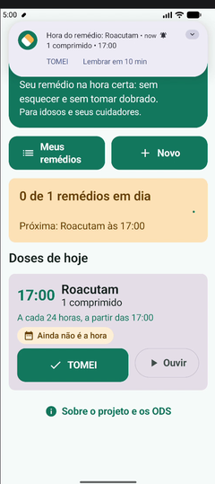 | 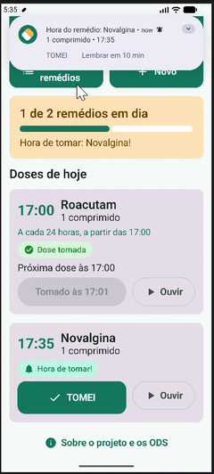 |

### 1. Primeira abertura

| Permissão de notificações | Tela inicial vazia | Sobre o projeto e ODS |
|---|---|---|
| 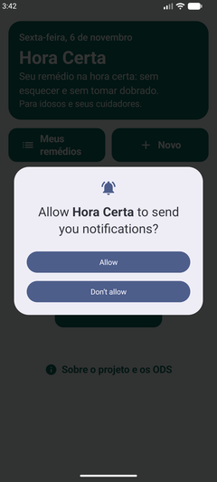 | 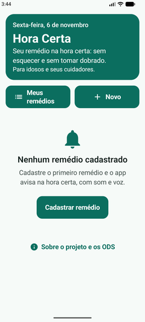 | 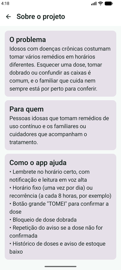 |

### 2. Cadastro com horário fixo

| Formulário | Escolhendo a hora | Escolhendo o minuto | Preenchido |
|---|---|---|---|
| 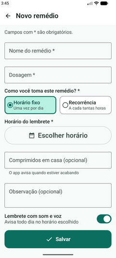 | 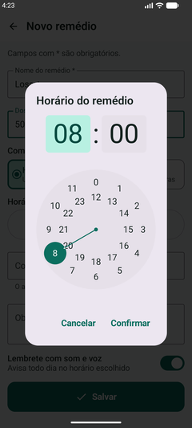 | 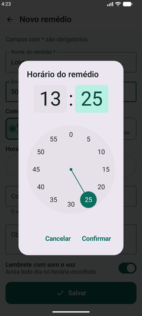 | 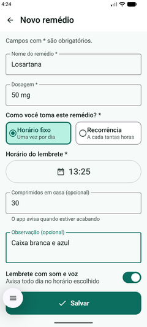 |

O lembrete com som e voz pode ser desligado já no cadastro ([print](docs/prints/07-cadastro-lembrete-desligado.png)).

**Validação:** ao tocar em **Salvar** sem preencher, cada campo obrigatório mostra o que falta, em vermelho e logo abaixo do campo.

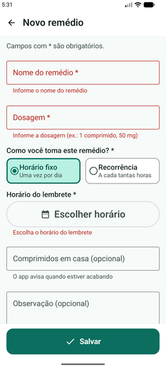

### 3. Cadastro com recorrência

| Opção "Recorrência" | Recorrência preenchida com prévia dos lembretes |
|---|---|
| 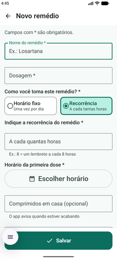 | 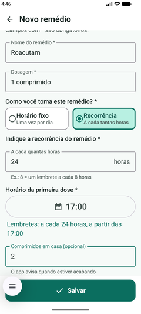 |

### 4. Tela inicial e ação extra: TOMEI

| Doses de hoje | Dose atrasada | Dose tomada (fixo) | Dose tomada (recorrência) |
|---|---|---|---|
| 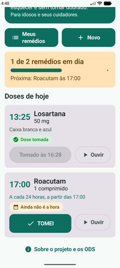 | 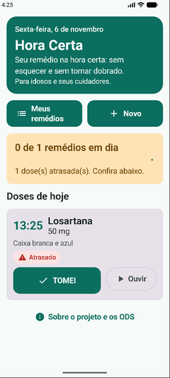 | 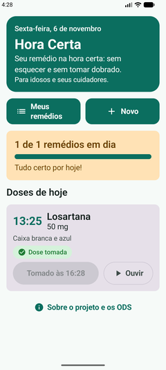 | 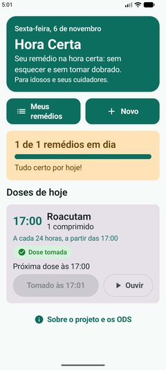 |

### 5. Meus remédios: lembrete, edição e exclusão

| Lista | Lembrete desligado | Lembrete ligado |
|---|---|---|
| 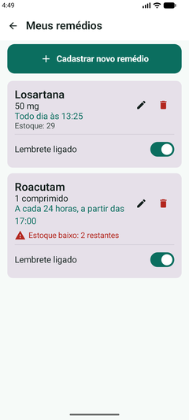 | 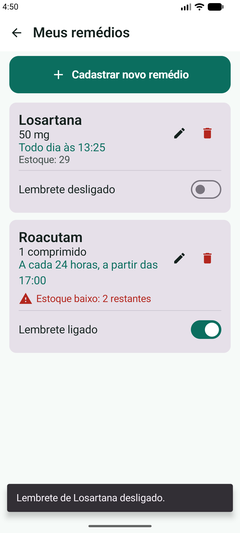 | 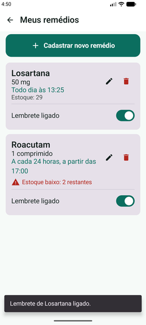 |

| Editando (50 mg → 60 mg) | Editado | Confirmação de exclusão | Excluído |
|---|---|---|---|
| 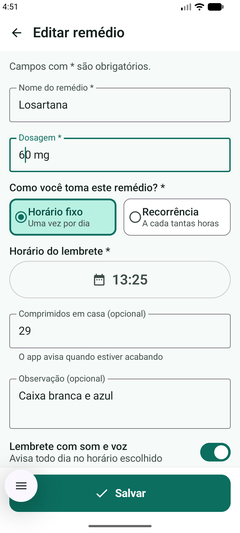 |  | 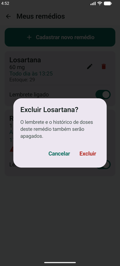 | 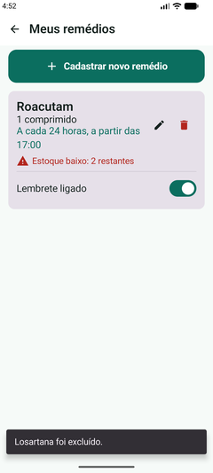 |

### 6. Detalhe e histórico de doses

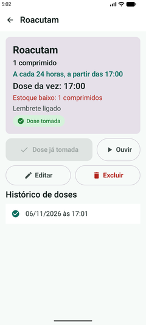

### 7. Persistência com Room

| 1. Registro salvo | 2. App fechado (sem apps recentes) | 3. Abrindo o app de novo | 4. Dados mantidos |
|---|---|---|---|
|  | 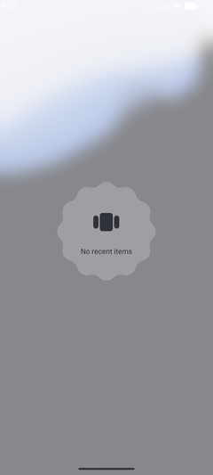 | 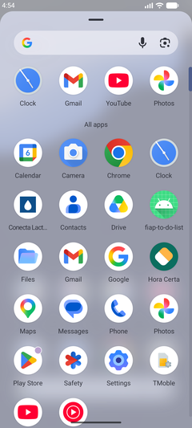 | 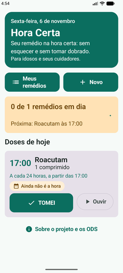 |

O remédio "Roacutam", cadastrado com recorrência, continua salvo depois de o app ser encerrado pela tela de apps recentes e aberto novamente.

---

## Como executar

**Requisitos:** Android Studio com suporte ao AGP 9.2, internet no primeiro build (para o Gradle baixar as dependências) e um emulador ou aparelho com **Android 7.0 (API 24) ou superior**.

### Opção A: pelo arquivo .zip (entrega)

1. **Extraia** o arquivo `.zip` para uma pasta do computador. No Windows: botão direito → *Extrair tudo...*. Não abra o projeto de dentro do .zip, porque o Android Studio não consegue compilar assim.
2. Abra o **Android Studio** e escolha **File → Open** (ou **Open** na tela inicial).
3. Selecione a pasta que contém os arquivos `settings.gradle.kts`, `build.gradle.kts` e a pasta `app`. Se, ao extrair, o Windows criar uma pasta dentro de outra com o mesmo nome, entre nela até achar esses arquivos.
4. Se o Android Studio perguntar se confia no projeto, escolha **Trust Project**.
5. Aguarde o **Gradle Sync** terminar (barra de progresso no rodapé). Na primeira vez, leva alguns minutos.
6. Escolha o emulador ou o aparelho no topo e clique em ▶ **Run 'app'**.
7. Na primeira abertura do app, **permita as notificações**.

> Se o Sync falhar com erro de cache do Gradle ("Cannot load transformed entry..."), feche o Android Studio, apague a pasta `C:\Users\<seu usuário>\.gradle\caches\9.4.1` e abra o projeto de novo.

### Opção B: clonando do GitHub

1. Clone o repositório:
   ```
   git clone https://github.com/Biloschycki/GS-ANDROID-KOTLIN-2-SEMESTRE.git
   ```
2. No Android Studio, escolha **File → Open** → pasta clonada (`GS-ANDROID-KOTLIN-2-SEMESTRE`).
3. Siga a partir do passo 4 da opção A.

### Testando o lembrete rapidamente

1. Cadastre um remédio com horário **2 minutos à frente** do relógio do aparelho.
2. Volte para a tela inicial do Android (pode bloquear a tela).
3. No horário, a notificação aparece e o texto é lido em voz alta.
4. Toque em **TOMEI** na notificação e abra o app: o cartão estará verde.

> **Voz no emulador:** se não ouvir nada, verifique em *Configurações → Acessibilidade → Saída de texto para fala* se há voz em português instalada e se o volume de mídia do emulador está ligado.
>
> **Aparelhos Xiaomi, Samsung, Motorola etc.:** alguns fabricantes bloqueiam alarmes para economizar bateria. Se o lembrete não tocar, libere o app em *Bateria → Sem restrições*.

### Testes

- Unitários (JVM): `./gradlew test` (regras de horário fixo, recorrência, próxima dose e validação do formulário).
- Instrumentados (emulador ligado): `./gradlew connectedAndroidTest` (Room + repositório: salvar, editar, registrar dose, bloquear dose dobrada no fixo e na recorrência, excluir em cascata).

---

## Limitações e próximos passos

- O alerta ao familiar quando a dose não é confirmada **não está implementado** (exigiria backend). Hoje o app repete o aviso para o próprio usuário.
- Próximos passos: perfil do cuidador com alerta remoto, leitura da receita por foto (OCR) e relatório de adesão para levar à consulta.
